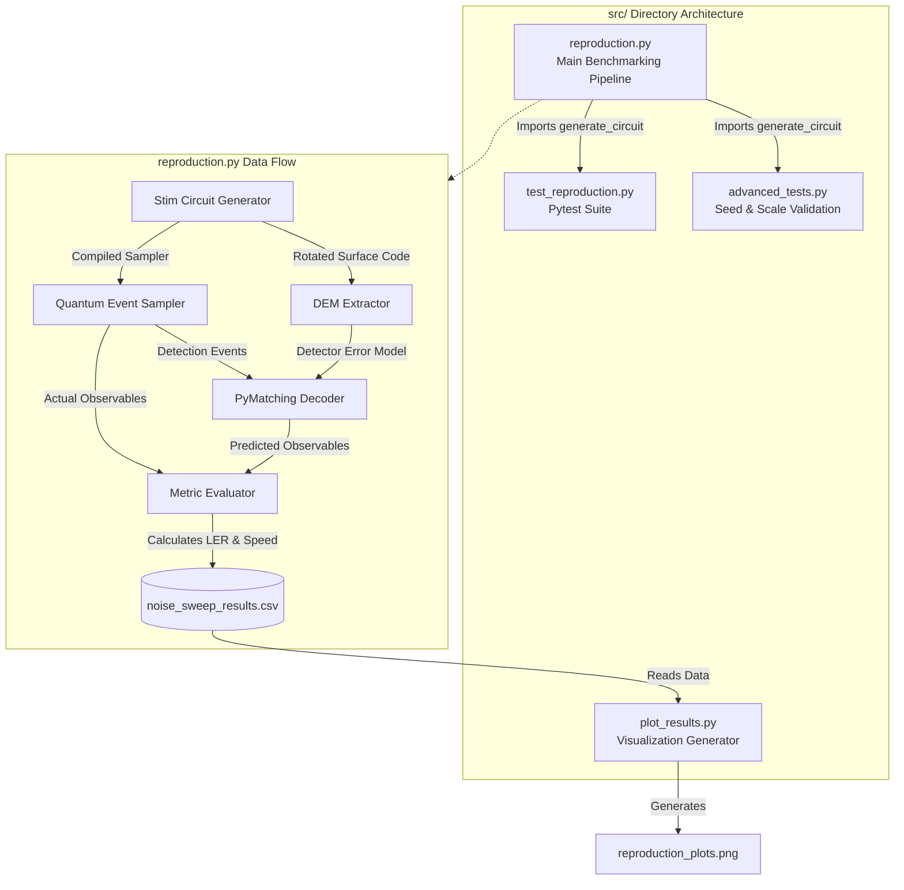
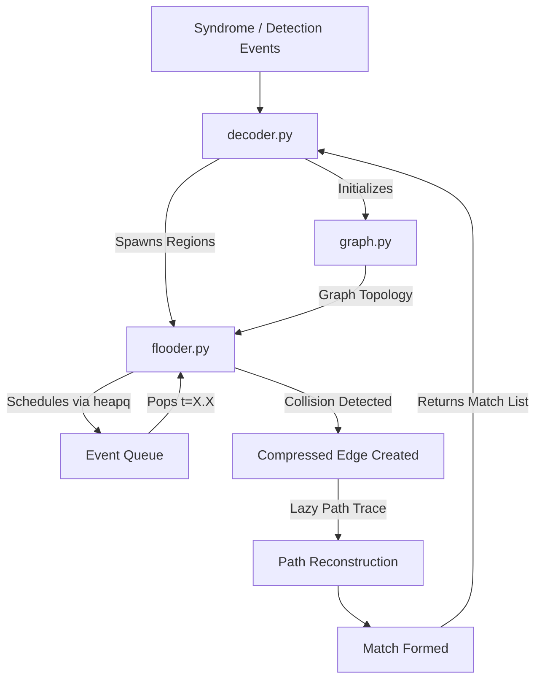
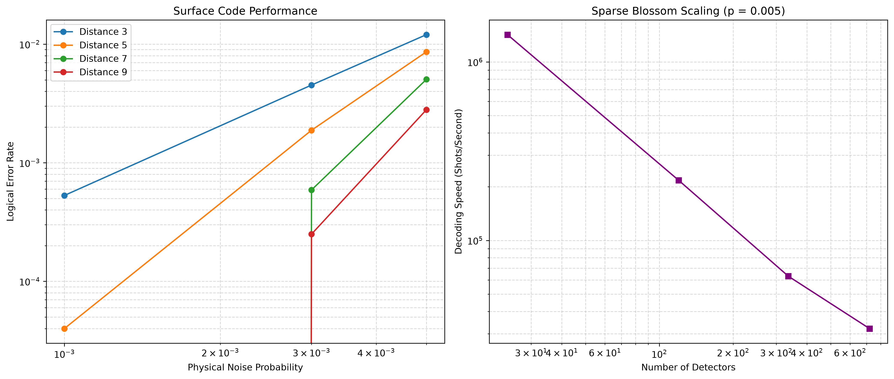

# Sparse Blossom Reproduction

An independent reproduction of the benchmarking workflow described in **[Sparse Blossom: correcting a million errors per core second with minimum-weight matching](https://arxiv.org/abs/2303.15933)** by Higgott and Gidney, together with a small Python reference implementation of selected flooding mechanics.

This repository contains two separate components:

- **Stim–PyMatching benchmark:** generates rotated surface-code memory circuits with Stim, samples detection events, decodes them using PyMatching 2, and records logical error rates and decoding performance. PyMatching 2 provides the production Sparse Blossom decoder used by this benchmark.
- **Reference flooder:** a readable Python implementation of region growth, event scheduling, collision handling, compressed observable tracking, and path reconstruction on small detector graphs. It is intended for studying the mechanics, not as a complete Sparse Blossom decoder.

## Repository structure

```text
sparse_blossom_reproduction/
├── src/
│   ├── reproduction.py          # Circuit generation, DEM extraction, sampling,
│   │                            # batch decoding, timing, and CSV output
│   ├── plot_results.py          # Generates plots from the benchmark CSV
│   ├── advanced_tests.py        # Seed-repeatability check and distance-11 run
│   └── test_reproduction.py     # Benchmark pipeline tests
├── results/
│   ├── noise_sweep_results.csv  # Recorded benchmark results
│   └── reproduction_plots.png  # Generated result visualisation
├── reference_decoder/
│   ├── graph.py                 # Detector graph and matching data structures
│   ├── flooder.py               # Event queue, regions, and collision handling
│   ├── decoder.py               # ReferenceDecoder interface
│   └── tests.py                 # Small-graph validation cases and event logs
├── requirements.txt
└── README.md
```

## Architecture

### 1. Benchmarking pipeline

The first diagram shows the `src/` module relationships and the data flow through `reproduction.py`. Stim supplies both the sampled detection events and the detector error model; PyMatching decodes the events, and the evaluator compares predicted observables with the sampled observables.



### 2. Reference flooder

The second component is independent of the benchmarking pipeline. `decoder.py` creates a detector graph and starts one region for each detection event. `flooder.py` processes scheduled events in time order using `heapq`; collisions produce compressed edges and matches, with paths reconstructed from parent pointers for inspection.



## Benchmark configuration

| Parameter | Configuration |
|---|---|
| Circuit | `surface_code:rotated_memory_x` |
| Rounds | Equal to code distance |
| Distances in main sweep | 3, 5, 7, 9 |
| Additional run | Distance 11 at `p = 0.005` |
| Physical error probabilities | `0.001`, `0.003`, `0.005` |
| Main shots per configuration | 100,000 |
| Detector error model | `decompose_errors=True` |
| Decoder | PyMatching 2.4.0 (`Matching.from_detector_error_model`) |
| Timed operation | `decode_batch()` only |

For each configuration, the pipeline generates the circuit, extracts a decomposed detector error model, creates a PyMatching decoder, and samples detection events and actual observables from Stim. It times the batch decoding call, compares predicted and actual observables, and records the logical failures, logical error rate (LER), decoding time, throughput, and detector count.

The generated circuit uses the same `p` for Stim's `after_clifford_depolarization`, `after_reset_flip_probability`, and `before_measure_flip_probability` parameters. `before_round_data_depolarization` is left at its default value of zero.

## Results

The main sweep uses 100,000 shots per configuration. The following table shows the recorded results at `p = 0.005`; the distance-11 result comes from a separate run.

| Code distance | Detectors | Logical failures | Logical error rate | Decoding speed (shots/s) |
|---:|---:|---:|---:|---:|
| 3 | 24 | 1,203 | `1.203 × 10⁻²` | `1.42 × 10⁶` |
| 5 | 120 | 862 | `8.62 × 10⁻³` | `2.17 × 10⁵` |
| 7 | 336 | 505 | `5.05 × 10⁻³` | `6.30 × 10⁴` |
| 9 | 720 | 280 | `2.80 × 10⁻³` | `3.21 × 10⁴` |
| 11 | 1,320 | 176 | `1.76 × 10⁻³` | `1.14 × 10⁴` |

The recorded results show decreasing logical error rates as code distance increases at fixed noise. Decoding throughput decreases as detector count increases. For the main sweep (distances 3–9), the fitted exponents for total decoding time versus detector count were 0.99, 1.06, and 1.13 at `p = 0.001`, `0.003`, and `0.005`, respectively. Including the separate distance-11 point at `p = 0.005` gives an exponent of 1.17.

### Generated plots

The figure below contains the logical-error-rate sweep and the decoding-throughput scaling plot.



At `p = 0.001`, the distance-7 and distance-9 main-sweep configurations had zero observed failures in 100,000 shots. These are upper-bound observations (approximately `LER < 3 × 10⁻⁵` at 95% confidence), not measured zero error rates. Zero-failure points cannot be displayed directly on logarithmic axes, so the corresponding portions of the plotted curves should be interpreted with care.

## Setup

The recorded environment used Python 3.14.7, Stim 1.16.0, PyMatching 2.4.0, NumPy 2.5.4, and pytest 9.2.0. The project also uses pandas and Matplotlib for result storage and plotting. Install the dependencies from the repository's `requirements.txt`.

```bash
# Create and activate a virtual environment
python -m venv .venv

# Windows PowerShell
.venv\Scripts\Activate.ps1

# macOS / Linux
source .venv/bin/activate

# Install dependencies
python -m pip install --upgrade pip
pip install -r requirements.txt
```

## Run

Run the commands from the repository root. Create the results directory if it does not already exist.

```bash
# Windows PowerShell
New-Item -ItemType Directory -Force results

# macOS / Linux
mkdir -p results
```

Run the main noise sweep and generate the plots:

```bash
python src/reproduction.py
python src/plot_results.py
```

Run the additional seeded-repeatability and distance-11 experiment:

```bash
python src/advanced_tests.py
```

Run the benchmarking regression tests:

```bash
pytest src/test_reproduction.py
```

The recorded test run passed all three tests. Noiseless decoding checks also produced zero logical failures for distances 3, 5, and 7 with 1,000 shots per distance.

## Reference decoder scope

The reference implementation is deliberately smaller than the production algorithm. It implements growing regions, node-level `ARRIVE` events, boundary events, collision detection, compressed edges with observable bitmasks, and parent-pointer path reconstruction. Its event queue uses Python's `heapq`.

It does **not** implement shrinking regions (`LEAVE` / `IMPLODE`), the alternating-tree matcher, blossom formation and shattering, or the production tracker's reminder/radix-heap strategy. A collision immediately marks the two regions as matched, making this a greedy first-collision reference flooder rather than a general minimum-weight embedded-matching solver. The small-graph cases are checked against hand-derived event traces; the reference decoder has not been cross-validated against PyMatching.

## Reproduction notes and limitations

- The implemented Stim noise configuration is from the same general circuit-level family as the paper's model, but it is **not identical**. In particular, Stim's after-Clifford depolarisation also affects single-qubit Clifford gates, and before-round data depolarisation is not enabled.
- The benchmark uses PyMatching 2.4.0 and the tested distance range is smaller than the paper's large-distance experiments. Hardware details for this run were not recorded.
- Timing covers `decode_batch()` and excludes circuit generation, DEM extraction, and sampling. Treat the reported throughput and scaling as measurements of this setup, not as direct performance comparisons with the paper.
- The paper's speed-up comparisons against PyMatching v0.7 and a NetworkX-based decoder, its threshold estimate, and its large-distance throughput claims were not reproduced.

## Reference

O. Higgott and C. Gidney, “Sparse Blossom: correcting a million errors per core second with minimum-weight matching,” *Quantum*, vol. 9, p. 1600, 2025. [arXiv:2303.15933](https://arxiv.org/abs/2303.15933).
